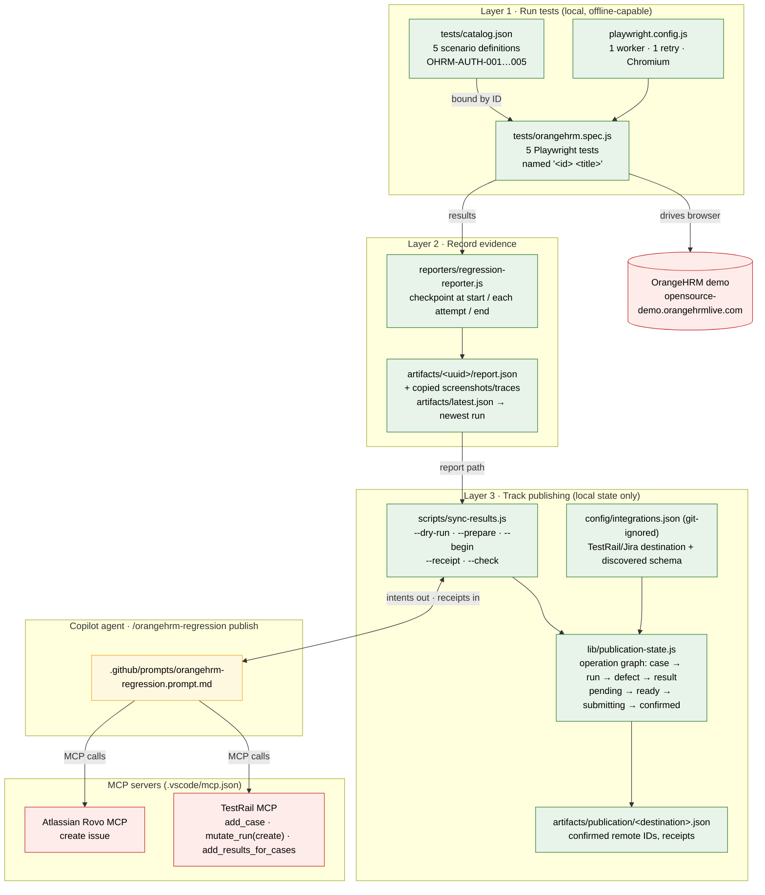

# Block 1 diagram — how the three layers fit together

Shows only what the linked code does. Open with VS Code Markdown Preview (Ctrl+Shift+V) to render.

Legend: green = code/files in this repo that run on your machine · red = remote systems · yellow = the AI agent, which is the **only** thing that ever talks to TestRail or Jira. `sync-results.js` never performs a remote write; it only hands the agent a payload ("intent") and records what the agent reports back ("receipt").
